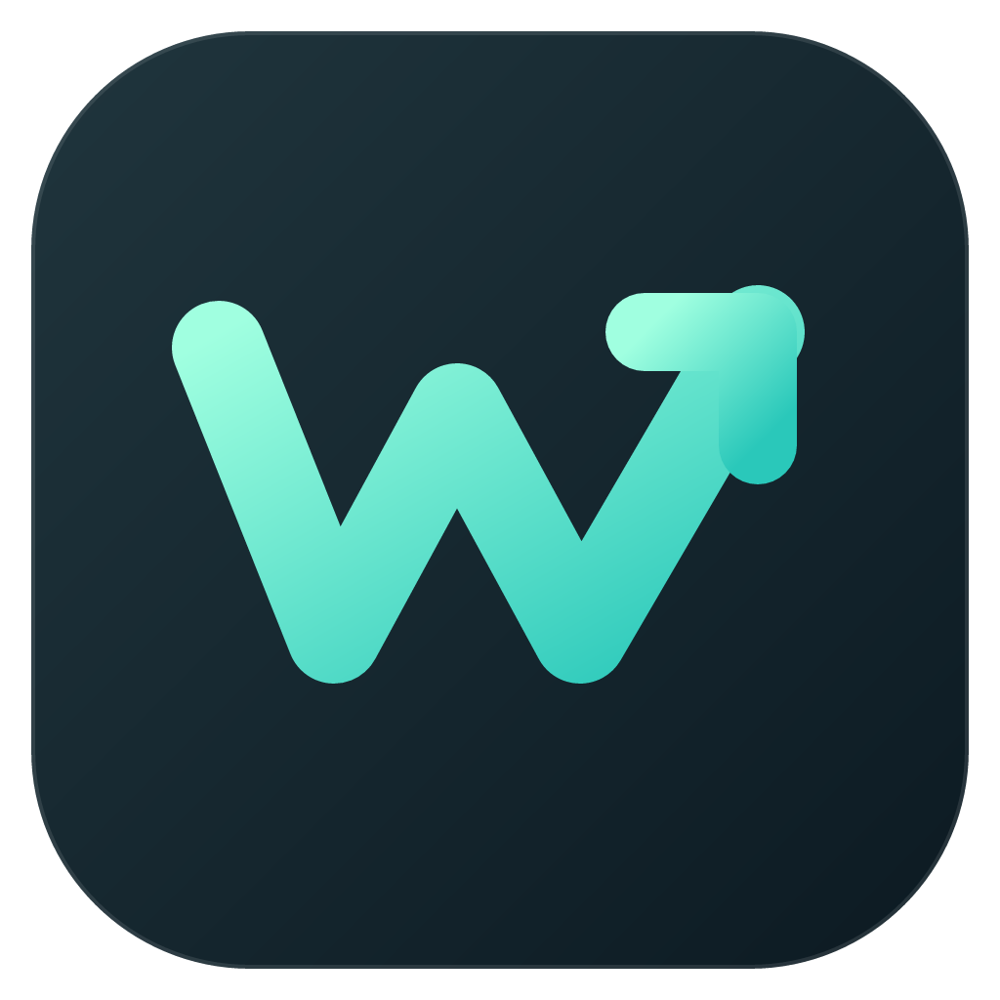

# wincast

A lightweight launcher for Windows. Press **Alt+Space** to open apps, find things, calculate and handle everyday tasks.

[简体中文](README.md) | **English**

## Install

Requires **Windows 11 24H2 or later, x64**.

[Download the latest release](https://github.com/YYHCOPPOLO/wincast/releases/latest). Run the installer, or extract the portable ZIP and run `wincast.exe`. The app stays in the tray. Press **Alt+Space** to get started.

For portable upgrades, replace the app in its original directory and keep the `data` folder.

## Features

- **Launch and search**: fuzzy app and file search, with favorites for frequently used apps.
- **Clipboard history**: text and images, with search, pinning and paste.
- **Calculate and look up**: math, units, currencies, dates and an offline dictionary.
- **Desktop controls**: volume, system actions and window layouts.
- **Notes and shortcuts**: notes, text snippets, custom commands and quicklinks.
- **AI assistant**: connect your own AI service for chat and quick actions.

Right-click the tray icon to open **Settings**. Enable more features, change shortcuts, switch languages and choose a light or dark theme. Glass backgrounds and settings backups are supported.

AI requires your own API key. The offline dictionary needs a separate ECDICT data installation; see below.

## Shortcuts

| Action | Keys |
| --- | --- |
| Show / hide the palette | Alt+Space |
| Run the selected result | Enter |
| Clear / go back / close | Esc |
| Switch modes | Tab |
| Clipboard history | Ctrl+~ |
| Actions for the current result | Ctrl+K |
| Open a favorite app | Ctrl+1…9, Ctrl+0 |

<details>
<summary>Build from source and install the dictionary</summary>

Install [Go 1.27.3](https://go.dev/dl/), then run from the repository directory:

```powershell
cd go
go tool mygo build -platform windows/amd64
.\build\windows-amd64\wincast.exe
```

To install the dictionary, run this from the repository root. It downloads and builds the local dataset. Use `-Force` to rebuild an existing dictionary; quit wincast before rebuilding.

```powershell
pwsh -NoProfile -File tools/build-dict.ps1
```

</details>

MIT. An independent implementation, with design and interaction inspired by [Tinycast](https://github.com/abue-ammar/tinycast). Dictionary data: [ECDICT](https://github.com/skywind3000/ECDICT) (MIT).
