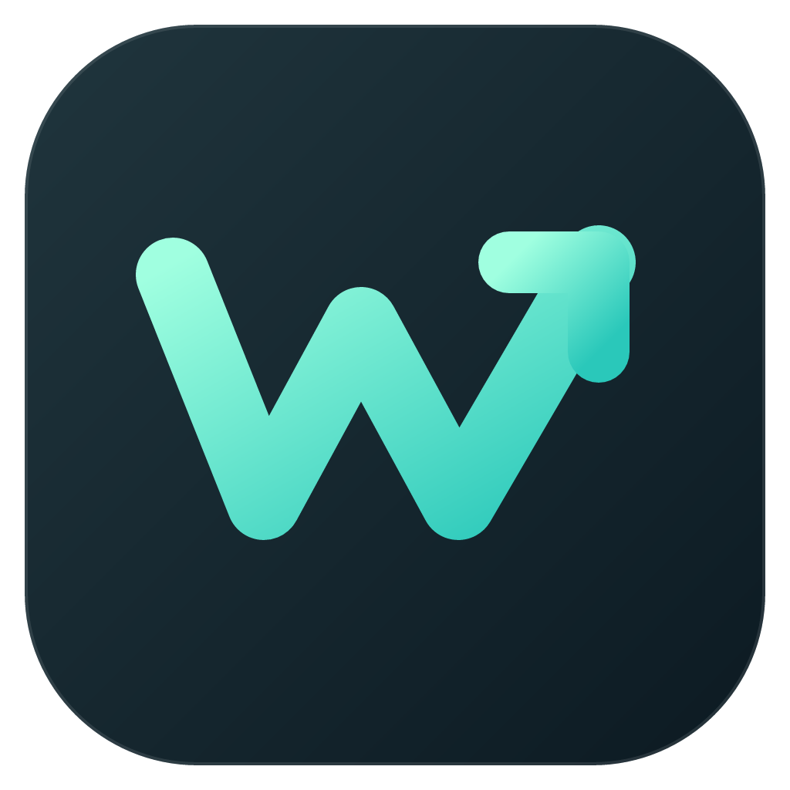

# wincast

Windows 上的轻量快捷启动器。按 **Alt+Space**，快速打开应用、查找内容、计算和处理日常任务。

**简体中文** | [English](README.en.md)

## 安装

需要 **Windows 11 24H2 或更新版本，x64**。

前往 [下载最新版](https://github.com/YYHCOPPOLO/wincast/releases/latest)，选择安装包，或解压便携包后运行 `wincast.exe`。程序常驻托盘，按 **Alt+Space** 开始使用。

便携版升级时，把程序放回原目录，保留 `data` 文件夹即可。

## 能做什么

- **启动与搜索**：模糊搜索应用和文件，收藏常用应用。
- **剪贴板历史**：保存文本与图片，支持搜索、置顶和粘贴。
- **计算与查词**：数学运算、单位与汇率换算、日期计算、离线词典。
- **桌面操作**：控制音量、执行系统操作、调整窗口布局。
- **记录与快捷输入**：笔记、文本片段、自定义命令和快捷链接。
- **AI 助手**：连接自己的 AI 服务，进行对话和快捷处理。

右键托盘图标打开**设置**，可启用更多功能、修改快捷键、切换语言及深浅色主题。支持毛玻璃背景和设置备份。

AI 需要填写自己的 API Key。离线词典需单独安装 ECDICT 数据，方法见下方。

## 常用快捷键

| 操作 | 快捷键 |
| --- | --- |
| 显示 / 隐藏面板 | Alt+Space |
| 执行当前结果 | Enter |
| 清空 / 返回 / 关闭 | Esc |
| 切换模式 | Tab |
| 剪贴板历史 | Ctrl+\`（可在 设置 → 剪贴板 → 命令 中修改） |
| 当前结果的操作菜单 | Ctrl+K |
| 打开收藏应用 | Ctrl+1…9、Ctrl+0 |

<details>
<summary>源码构建与词典安装</summary>

安装 [Go 1.27.3](https://go.dev/dl/) 后，在仓库目录执行：

```powershell
cd go
go tool mygo build -platform windows/amd64
.\build\windows-amd64\wincast.exe
```

安装词典：在仓库根目录执行以下命令，自动下载并生成本地词典数据。已有词典时用 `-Force` 重建；重建前请退出 wincast。

```powershell
pwsh -NoProfile -File tools/build-dict.ps1
```

</details>

MIT。独立实现，设计与交互参考 [Tinycast](https://github.com/abue-ammar/tinycast)。词典数据来自 [ECDICT](https://github.com/skywind3000/ECDICT)（MIT）。
